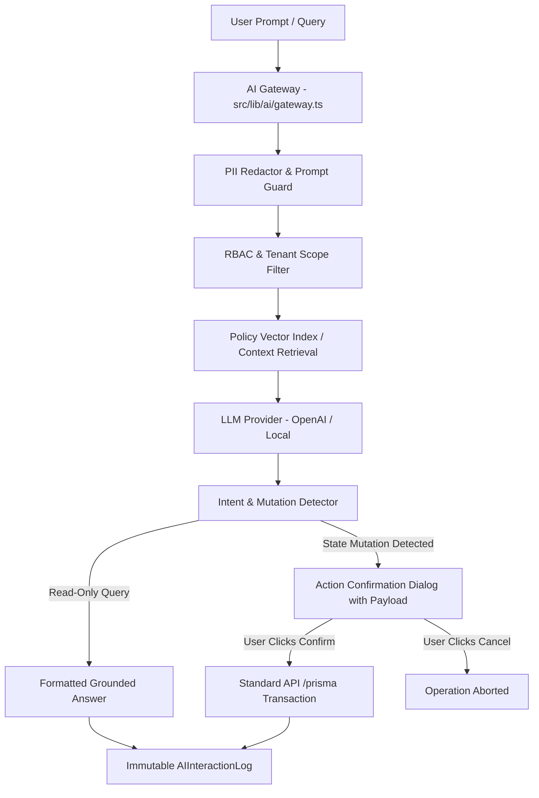

# AI GATEWAY, RAG & SAFETY ARCHITECTURE
**Project:** AI Automation Labs Multi-Tenant HRMS & SaaS Platform  
**Master Source of Truth:** Master Developer Specification (Section 21: AI Layer)  
**AI Operating Mode:** Assistive, Grounded RAG, Role-Gated with Human Confirmation  

---

## 1. AI Layer Design Principles

The HRMS AI subsystem is engineered around **four non-negotiable safety guardrails**:

1. **Strict Multi-Tenant Isolation:** Embeddings and document chunks are strictly partitioned by `tenant_id`. No cross-tenant vector contamination is possible.
2. **Zero RBAC Bypass:** Context retrieval is filtered by the requesting actor's RBAC role. An unauthorized employee querying salary data receives a permission error.
3. **Mandatory Human-in-the-Loop Confirmation:** The AI Gateway never mutates database state directly. Any action (e.g., submitting leave, approving expenses) returns a confirmation prompt requiring explicit human interaction.
4. **PII Masking & Prompt Sanitization:** Aadhaar, PAN, and full bank account numbers are redacted before context is transmitted to LLM inference endpoints.

---

## 2. AI Subsystem Components

---

## 3. Verified Capabilities & Test Assertions

* **Employee AI Assistant:** Answers PTO balance questions, explains payslip line items, and assists with leave drafts.
* **HR AI Co-Pilot:** Queries internal company policies using grounded RAG, provides headcount and turnover summaries.
* **ATS Resume Matcher:** Compares candidate resumes against job requisitions, generating a weighted skill-fit match score (0–100%).
* **Anomaly Detection:** Flags overlapping shifts, negative leave balance requests, and unexpected overtime surges.
* **Adversarial Safety Tests:** Verified in `tests/ai-advanced-safety.test.ts`.
