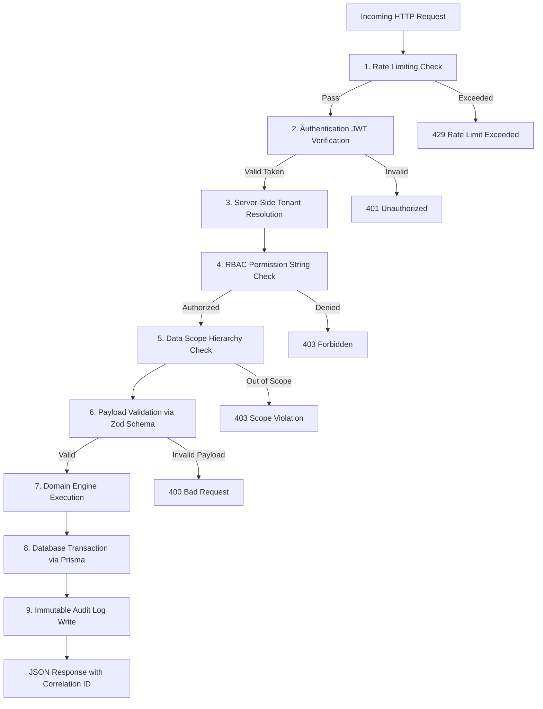
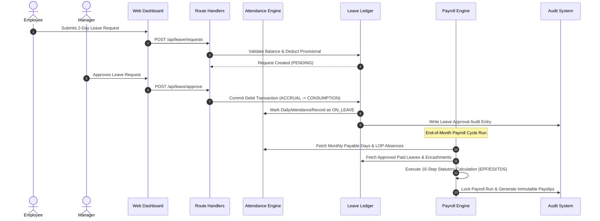

# SYSTEM ARCHITECTURE & DATA FLOW
**Project:** AI Automation Labs Multi-Tenant HRMS & SaaS Platform  
**Master Source of Truth:** Master Developer Specification (37 Sections)  

---

## 1. High-Level Modular Monolith Architecture

The platform is designed as a **clean, modular monolith** utilizing Next.js 15 App Router, React Server Components (RSC), and Prisma ORM.

```mermaid
graph TD
    Client[Web Browser / Mobile Viewport] -->|HTTPS / TLS 1.3| NextJS[Next.js 15 Application Server]
    
    subgraph NextJS [Next.js 15 Application Server]
        Middleware[Auth & Tenant Middleware]
        AppRouter[App Router / SSR Pages]
        APIRouter[REST API Router /api/v1]
        
        subgraph DomainEngine [Domain Business Logic - src/lib]
            RBACEngine[RBAC & Scope Engine]
            PayrollEngine[16-Step Payroll Engine]
            AttendanceEngine[Attendance & Punch Engine]
            LeaveEngine[Double-Entry Leave Ledger]
            ATSEngine[ATS & Candidate Pipeline]
            OnboardingEngine[Onboarding Checklist Engine]
            DocEngine[Document & E-Sign Engine]
            PerfEngine[Performance & OKR Engine]
            ExpenseEngine[Dual-Tier Expense Engine]
            AssetEngine[Asset Lifecycle Engine]
            ExitEngine[Exit & Gratuity Engine]
            AIGateway[AI Gateway & RAG Engine]
            WebhookEngine[HMAC Webhook Dispatcher]
            AuditEngine[Before/After Audit Logger]
        end
    end
    
    NextJS -->|Prisma ORM Client| DB[(PostgreSQL 16 / SQLite Database)]
    NextJS -->|Cache & Rate Limit| Redis[(Redis / BullMQ Cache & Queues)]
    NextJS -->|Signed URLs| ObjectStorage[(S3 / R2 Object Storage)]
    AIGateway -->|Context Gated API| LLM[LLM Provider / Embeddings]
    WebhookEngine -->|Signed HTTPS POST| ExternalHooks[Tenant Webhook Receivers]
```

---

## 2. Request Lifecycle & Security-First Middleware Pipeline

Every HTTP request must pass through an immutable, multi-stage security pipeline before reaching business logic:

---

## 3. Multi-Tenant Data Isolation Architecture

Logical tenant isolation is strictly enforced at every level of the application stack:

1. **Database Layer:** Every tenant-owned entity includes a mandatory `tenant_id` foreign key with composite indexing (`@@index([tenant_id])`).
2. **Prisma Client Middleware:** Data access queries automatically scope all operations (`findMany`, `create`, `update`, `delete`) using the authenticated user's `tenant_id`.
3. **Storage Isolation:** S3 storage keys are partitioned by tenant: `/tenants/{tenant_id}/{module}/{year}/{file_id}`.
4. **Cache & Queues:** Redis cache keys and BullMQ job payloads are namespaced: `tenant:{tenant_id}:{key}`.
5. **AI Gateway:** Embeddings and document retrieval strictly filter vectors by `tenant_id`.

---

## 4. Domain Engine Interoperability

