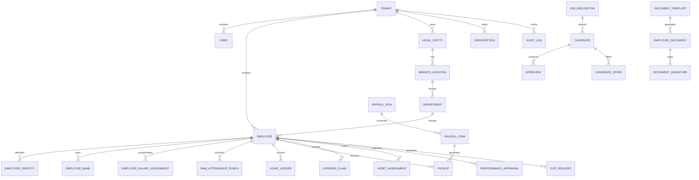

# DATABASE SCHEMA & DOMAIN MODEL DOCUMENTATION
**Project:** AI Automation Labs Multi-Tenant HRMS & SaaS Platform  
**Master Source of Truth:** Master Developer Specification (37 Sections)  
**ORM Engine:** Prisma ORM 6.4 (PostgreSQL 16 / SQLite)  

---

## 1. Complete Entity Relationship Overview

The database contains **32 tightly integrated relational domain models** organized into 11 distinct business modules:

---

## 2. Core Relational Models Summary

### Multi-Tenancy & Platform Administration
* `Tenant` — Master company tenant entity with status (`ACTIVE`, `TRIAL`, `SUSPENDED`), plan, and branding JSON.
* `Subscription` — Plan limits, active employee seat quotas, billing intervals, and 30-day trial dates.
* `SupportImpersonationLog` — Immutable record of Super Admin impersonation sessions with ticket reference IDs.
* `SupportTicket` — Helpdesk tickets raised by tenant admins.

### Identity & Organization Master
* `User` — Authentication credentials, bcrypt password hash, account status, and role bindings.
* `Role` & `Permission` — RBAC definitions, machine-readable permission strings, and role descriptions.
* `LegalEntity` — Corporate entity registration, GSTIN, PAN, and registered address.
* `BranchLocation` — Physical operating offices with geolocation coordinates for geofencing.
* `Department` & `Designation` & `Grade` — Organizational hierarchy and job grading structures.
* `Employee` — Master employment record, corporate email, reporting hierarchy, and employment status.
* `EmployeeIdentity` — Sensitive government IDs (PAN, Aadhaar, Passport) with field-level encryption.
* `EmployeeBank` — Banking details (Account Number, IFSC, Bank Name) for direct salary disbursement.
* `CustomFieldDefinition` & `EmployeeCustomField` — Extensible tenant custom field data store.

### Attendance & Leave Management
* `ShiftPolicy` — Shift timings, 15-minute grace windows, minimum half-day/full-day durations, overtime rules.
* `RawAttendancePunch` — Append-only immutable punch event log (timestamp, punch type, GPS coordinates, device ID).
* `DailyAttendanceRecord` — Aggregated daily status (`PRESENT`, `HALF_DAY`, `LATE`, `ON_LEAVE`, `ABSENT`).
* `AttendanceRegularization` — Correction request with proposed times, justification, and manager approval status.
* `LeaveType` & `LeavePolicy` — Configurable leave quotas, carry-forward caps, encashment, and sandwich rules.
* `LeaveLedger` — Double-entry balance transaction log (`ACCRUAL`, `CONSUMPTION`, `ENCASHMENT`, `LAPSE`).
* `LeaveRequest` — Formal leave application with date intervals, reason, and approval workflow.

### Payroll & Statutory Compliance
* `SalaryComponent` — Earning and deduction components (BASIC, HRA, SPECIAL_ALLOWANCE, PF, ESI, PT, TDS).
* `SalaryStructure` — Reusable CTC templates and formula-based component breakdown.
* `EmployeeSalaryAssignment` — Effective-dated salary structure assignment per employee.
* `PayrollRun` — Monthly payroll batch record with state machine (`DRAFT` → `CALCULATED` → `APPROVED` → `LOCKED`).
* `PayrollItem` — Line-item earnings and statutory deductions per employee.
* `Payslip` — Printable, tamper-evident monthly payslip with gross, deductions, and net payout.
* `StatutoryRuleSet` — Versioned ruleset storing EPF, ESI, PT slabs, and TDS tax regimes (Old vs New).
* `PayrollAdjustment` — Manual payroll override tracking before/after values and mandatory reason.

### ATS, Onboarding, Documents, Performance, Expenses & Assets
* `JobRequisition` & `Candidate` & `Interview` & `CandidateOffer` — Complete ATS lifecycle.
* `OnboardingTemplate` & `OnboardingTask` & `OnboardingInstance` & `OnboardingItem` — Playbooks & verification.
* `DocumentTemplate` & `EmployeeDocument` & `DocumentSignature` — E-Sign templates & SHA-256 signatures.
* `PerformanceCycle` & `PerformanceGoal` & `PerformanceAppraisal` — OKRs, reviews & calibrated ratings.
* `ExpenseClaim` & `ExpenseReceipt` — Multi-category claims, receipts & dual approval tracking.
* `Asset` & `AssetAssignment` — IT hardware register, allocation history & condition logs.
* `ExitRequest` — Resignation workflow, IT/Admin/Finance clearance, Statutory Gratuity & F&F statement.

### Security, Webhooks & AI
* `AuditLog` — Comprehensive immutable audit table capturing timestamp, actor, IP, action, entity, and before/after JSON diffs.
* `WebhookSubscription` & `WebhookDeliveryLog` — HMAC-SHA256 signed event delivery tracking.
* `AIInteractionLog` — Audit trail for employee assistant and HR co-pilot queries.
