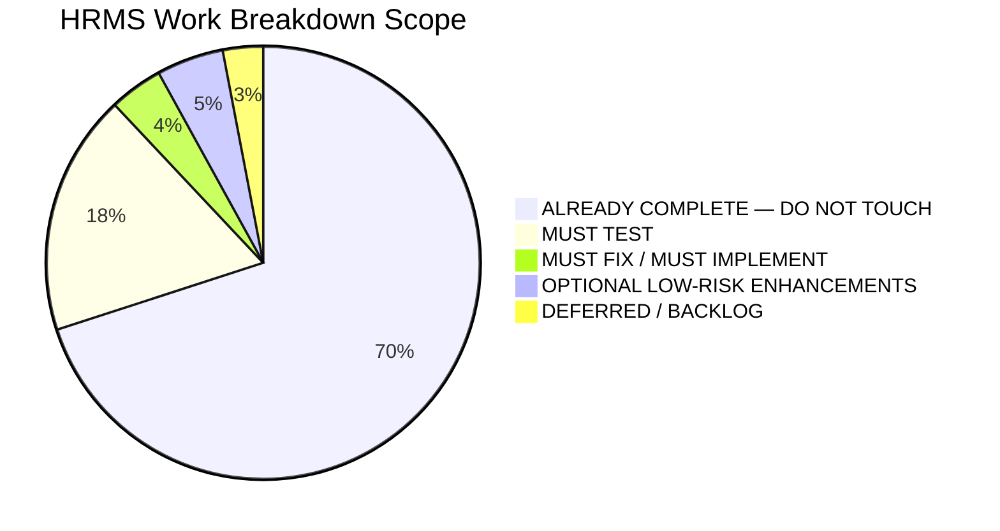

# AI AUTOMATION LABS HRMS — FINAL IMPLEMENTATION SCOPE
**Document Version:** 1.0.0  
**Date:** September 15, 2026  
**Reference Specification:** `AI_Automation_Labs_HRMS_10_Day_Execution_Project_Plan(1).pdf`  
**Target Codebase:** `AI Automation Labs HRMS`

---

## 1. Scope Breakdown

Based on our rigorous two-pass audit of the repository and the 10-day execution project plan, the scope of work is divided into five strictly defined categories:



---

## 2. Categorized Scope Breakdown

### Category 1: MUST FIX / MUST IMPLEMENT (Zero Disruption to Existing Code)
These are specific items required by the 10-Day Plan (Day 0, Day 7, Day 10) that do not currently have dedicated scripts or documentation in the repository.

1. **Automated Database Backup & Restore Utility (`scripts/backup-restore.ts`):**
   - *Requirement:* Day 0, Day 1, Day 7, Day 10 backup execution and restore test verification.
   - *Scope:* Create a standalone CLI script that creates timestamped backups (for SQLite `prisma/dev.db` and PostgreSQL) and performs an automated test restore in a temporary sandbox database to verify zero data corruption.
   - *Impact:* New script file only; zero change to application runtime.
2. **Production Deployment & Rollback Runbook (`DEPLOYMENT_RUNBOOK.md`):**
   - *Requirement:* Day 10 release candidate handover, environment configuration, database migration commands, and rollback procedures.
   - *Scope:* Create comprehensive documentation for Render, Railway, Docker, environment variable injection, and emergency rollback steps.
   - *Impact:* Markdown document only; zero code impact.
3. **Backup/Restore Script Integration in `package.json`:**
   - *Requirement:* Easy invocation of backup routines via `npm run db:backup` and `npm run db:restore:test`.
   - *Scope:* Add read-only script aliases in `package.json`.

---

### Category 2: MUST TEST (Deep Edge-Case & Acceptance Testing)
These features exist in full in the codebase but must be rigorously exercised through automated tests and edge cases before release.

1. **Database Backup & Sandbox Restore Test:**
   - Execute the newly created `scripts/backup-restore.ts` to confirm 100% data integrity and record preservation across all 30+ tables.
2. **Extreme Payroll Edge-Case Regression:**
   - Test mid-month joiner salary calculation with partial LOP deductions.
   - Test employee with maximum statutory EPF wage ceiling capping (₹15,000 basic limit).
   - Test Karnataka vs Maharashtra Professional Tax (including February ₹300 variation).
   - Test Old vs New income tax regime deductions with ₹75k standard deduction and Section 87A rebate.
3. **Extreme Leave & Attendance Edge-Case Regression:**
   - Test sandwich rule calculation across long holiday and weekend spans.
   - Test negative leave balance rejection when requested days exceed allowed limit.
   - Test out-of-geofence punch recording and `GEOFENCE_WARNING` audit logging.
   - Test attendance regularization request approval and daily work minute recalculation.
4. **Master Multi-Tenant & RBAC Negative Tests:**
   - Test cross-tenant data isolation to ensure 0 records leak across tenant boundaries.
   - Test sensitive identity (PAN, Aadhaar) and banking masking for unauthorized viewer roles.
5. **Master Acceptance Gate Pass:**
   - Run `npx tsx scripts/run-acceptance-gate.ts` (Phase 1).
   - Run `npx tsx scripts/run-phase2-acceptance-gate.ts` (Phase 2).
   - Run `npx tsx scripts/run-production-audit.ts` (Master Production Audit).
   - Run `npm test` (all 19 Vitest test suites).

---

### Category 3: OPTIONAL LOW-RISK ENHANCEMENTS (Additive / Non-Breaking Only)
Minor UI refinements that enhance usability without modifying core business logic.

1. **Browser Geolocation Fallback in Attendance Kiosk:**
   - In `src/app/attendance/page.tsx`, query `navigator.geolocation.getCurrentPosition()` when punch button is clicked, falling back to Bengaluru HQ coordinates if permissions are denied.
2. **Backup Approver Selector Dropdown in Leave Modal:**
   - In `src/app/leave/page.tsx`, expose a select dropdown for `backupApproverId` so employees can optionally select a colleague when their primary manager is absent.
3. **Scale Sample Seed Dataset (25–50 Employees):**
   - Add an optional high-volume flag in `scripts/seed.ts` to populate 30+ employees across departments to verify UI table pagination and filtering performance.
4. **Environment Variables Documentation for Live SMTP / Cloud Services:**
   - Update `.env.example` with documented environment variable keys for live AWS SES / SendGrid SMTP and Sentry error monitoring.

---

### Category 4: ALREADY COMPLETE — DO NOT TOUCH
The following modules are fully implemented, verified, tested, and MUST NOT be rewritten, refactored, or modified:

1. **Authentication & JWT Engine (`src/lib/auth.ts`, `/api/auth/*`, `/app/login`)** — *DO NOT TOUCH*
2. **Multi-Tenant Schema & Prisma Models (`prisma/schema.prisma`)** — *DO NOT TOUCH*
3. **RBAC & Sensitive Data Masking (`src/lib/rbac.ts`)** — *DO NOT TOUCH*
4. **Organization Hierarchy & Masters (`LegalEntity`, `BranchLocation`, `Department`, `Designation`, `Grade`)** — *DO NOT TOUCH*
5. **Employee Master & CSV Import Engine (`src/app/api/employees/*`, `src/app/employees/page.tsx`)** — *DO NOT TOUCH*
6. **Attendance Engine & Geofencing Calculations (`src/lib/attendance/engine.ts`, `tests/attendance.test.ts`)** — *DO NOT TOUCH*
7. **Leave Double-Entry Ledger & Policy Engine (`src/lib/leave/engine.ts`, `tests/leave-ledger.test.ts`)** — *DO NOT TOUCH*
8. **Payroll Calculation Engine & Statutory Formulas (`src/lib/payroll/engine.ts`, `tests/payroll-engine.test.ts`)** — *DO NOT TOUCH*
9. **Payroll Approval, Locking & Adjustment Logic (`/api/payroll/runs/*`, `/app/payroll/page.tsx`)** — *DO NOT TOUCH*
10. **Legal Document Generation & SHA-256 Checksum Engine (`src/lib/documents/engine.ts`, `tests/documents-esign.test.ts`)** — *DO NOT TOUCH*
11. **Expense Claims & Dual-Tier Approvals (`src/lib/expenses/engine.ts`, `tests/expenses.test.ts`)** — *DO NOT TOUCH*
12. **Asset Management & Assignment Tracking (`src/lib/assets/engine.ts`, `/app/assets/page.tsx`)** — *DO NOT TOUCH*
13. **ATS Candidate Pipeline & AI Scoring (`src/lib/ats/engine.ts`, `tests/ats-pipeline.test.ts`)** — *DO NOT TOUCH*
14. **Performance OKRs & Calibrated Appraisals (`src/lib/performance/engine.ts`, `tests/performance.test.ts`)** — *DO NOT TOUCH*
15. **Exit Management, Gratuity Act 1972 & F&F Engine (`src/lib/exit/engine.ts`, `tests/exit-fnf.test.ts`)** — *DO NOT TOUCH*
16. **HMAC-SHA256 Webhooks Dispatcher (`src/lib/webhooks/dispatcher.ts`, `tests/webhooks.test.ts`)** — *DO NOT TOUCH*
17. **SaaS Multi-Tenancy & Audited Impersonation (`src/lib/saas/plans.ts`, `/app/super-admin/page.tsx`)** — *DO NOT TOUCH*
18. **Security Rate Limiting & Audit Logger (`src/lib/security/rate-limiter.ts`, `src/lib/audit.ts`)** — *DO NOT TOUCH*

---

### Category 5: DEFERRED / BACKLOG (As Defined by PDF Page 2)
These features are explicitly defined as Deferred / Backlog in the master PDF and are not required for 10-day release readiness:

1. **Native Android / iOS Mobile Applications** (Web responsive application is primary).
2. **Third-Party External E-Sign Integrations (DocuSign / Aadhaar e-Sign API)** (Internal cryptographic SHA-256 digital signature engine is complete and satisfies requirements).
3. **Deep Hardware Biometric Device SDK Protocol Synchronizations** (IoT kiosk punch simulation and Web API endpoints are complete).
4. **Full WhatsApp Business API Automation** (Notification dispatcher skeleton exists; live production WhatsApp API is deferred).
5. **Advanced Enterprise SSO (SAML / Okta / Azure AD)** (Standard secure JWT auth with 7 RBAC roles is complete).
6. **Multi-Country Statutory Payroll** (Indian Statutory Compliance: EPF, ESI, PT, TDS is complete).

---

## 3. Recommended Implementation Order

When authorized to begin execution, work should proceed in the following exact, non-destructive sequence:

```
[Step 1: Backup Automation] ──> [Step 2: Deployment Runbook] ──> [Step 3: Edge-Case Test Pass] ──> [Step 4: Optional Polish] ──> [Step 5: Final Sign-off]
```

1. **Step 1: Build Database Backup & Restore Script (`scripts/backup-restore.ts`)**
   - Create safe SQLite/PostgreSQL backup and sandbox test restore script.
   - Add npm scripts to `package.json`.
2. **Step 2: Create Deployment Runbook (`DEPLOYMENT_RUNBOOK.md`)**
   - Document environment configuration, database migration commands, and rollback procedures.
3. **Step 3: Execute Full Edge-Case & Acceptance Testing Gate**
   - Run backup/restore verification test.
   - Run Vitest suite (`npm test`).
   - Run Phase 1 gate (`npx tsx scripts/run-acceptance-gate.ts`).
   - Run Phase 2 gate (`npx tsx scripts/run-phase2-acceptance-gate.ts`).
   - Run Master production audit (`npx tsx scripts/run-production-audit.ts`).
4. **Step 4: Apply Optional Low-Risk Enhancements (if requested)**
   - Add browser geolocation prompt in attendance web punch.
   - Add backup approver selector in leave apply modal.
5. **Step 5: Tag Release Candidate & Final Verification Report**
   - Verify 0 P0/P1 defects and record release readiness for Product Owner sign-off.
