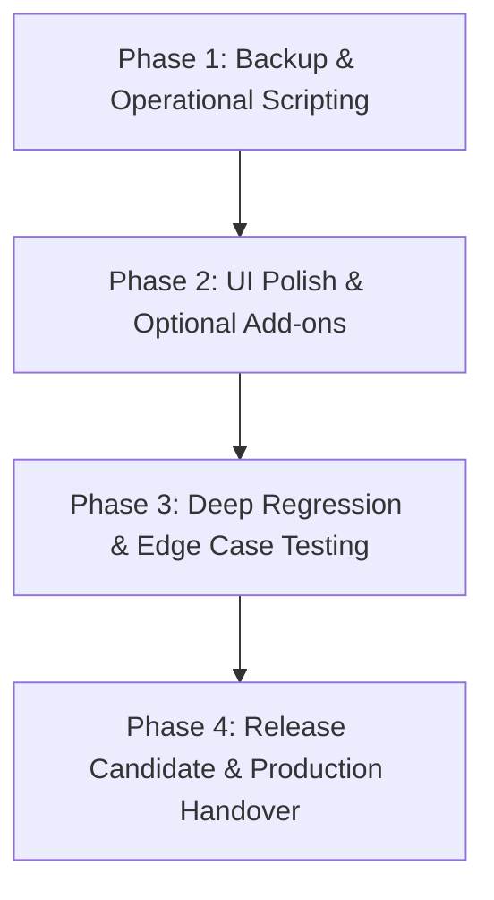

# AI AUTOMATION LABS HRMS — IMPLEMENTATION SAFETY PLAN
**Document Version:** 1.0.0  
**Date:** September 15, 2026  
**Reference Document:** `AI_Automation_Labs_HRMS_10_Day_Execution_Project_Plan(1).pdf`  
**Purpose:** Ensure zero-regression, non-destructive progression of the HRMS codebase from current state to production-ready deployment.

---

## 1. Non-Negotiable Safety Principles

The existing HRMS repository represents a fully functional, high-value asset with over 30 data models, 19 passing test suites, full-featured calculation engines, and interactive web pages. To protect system stability, the following safety rules are strictly enforced:

### Rule 1: Zero Destructive Changes
- **DO NOT rewrite the project or any working module.** All existing functions, classes, models, and utility files must remain intact.
- **DO NOT delete or drop existing database tables, columns, or seeded data.** Database schema changes must only be additive (new optional columns, new indexes, or backward-compatible relations).
- **DO NOT replace working business logic or calculation engines.** The tested logic in Payroll (`src/lib/payroll/engine.ts`), Attendance (`src/lib/attendance/engine.ts`), Leave (`src/lib/leave/engine.ts`), Documents (`src/lib/documents/engine.ts`), Expenses (`src/lib/expenses/engine.ts`), Assets (`src/lib/assets/engine.ts`), and Exit F&F (`src/lib/exit/engine.ts`) must be preserved.
- **DO NOT change working API route contracts or UI component structures unnecessarily.**

### Rule 2: Multi-Tenant Boundary Invariant
- Every database query, mutation, audit log, and background job MUST include explicit `tenantId` scoping.
- Global queries across tenants without `tenantId` are strictly forbidden outside of Super Admin support audit flows.

### Rule 3: Deterministic Financial & Statutory Integrity
- Statutory calculation rules (EPF, ESI, Professional Tax, TDS slabs, Gratuity formula) must remain versioned, parameterized, and fully deterministic.
- Payroll lock status (`status: 'LOCKED'`) must permanently block recalculations or silent updates to payroll items and payslips.

### Rule 4: Double-Entry Ledger Immutability
- Leave balances and financial adjustments must be derived strictly from historical transactional ledger entries (`LeaveLedger`, `PayrollAdjustment`), never mutated directly via raw overwrite.

---

## 2. Safety Invariants & Guardrails

| Module | Core Invariant | Guardrail Mechanism | Verification Test |
|---|---|---|---|
| **Multi-Tenancy** | Strict tenant isolation across all entities | `where: { tenantId }` on all Prisma queries | `tests/tenant-isolation.test.ts` |
| **RBAC** | Backend-enforced data scopes (`OWN`, `DIRECT_REPORTS`, `TENANT`) | `hasPermission()` & `filterSensitiveEmployeeData()` in `src/lib/rbac.ts` | `tests/rbac-permissions.test.ts` |
| **Attendance** | Immutable raw punches & geofence validation | `RawAttendancePunch` is append-only; distance checked via Haversine | `tests/attendance.test.ts` |
| **Leave Management** | Double-entry ledger accounting | Balances computed as `sum(days)`; consumption requires transactional credit/debit | `tests/leave-ledger.test.ts` |
| **Payroll Core** | Deterministic calculations & locked immutability | Tax formulas parameterized in `DEFAULT_STATUTORY_CONFIG`; locked runs are read-only | `tests/payroll-engine.test.ts` |
| **Legal Documents** | Cryptographic tamper evidence | SHA-256 hash computed on document generation and verified before signing | `tests/documents-esign.test.ts` |
| **Security & Auditing** | Comprehensive audit trail & rate limiting | `AuditLog` captures actor, IP, before/after state; API rate limiter active | `tests/security-audit-rate-limit.test.ts` |

---

## 3. Prioritized Implementation Roadmap

The remaining tasks are structured into a 4-phase, non-destructive sequence designed to achieve complete deployment readiness without disrupting existing capabilities.



### Phase 1: Operational Tooling & Backup Automation (Immediate Priority)
- **Goal:** Provide automated, testable backup and restore utilities without modifying application code.
- **Tasks:**
  1. Create standalone backup and restore script (`scripts/backup-restore.ts`) supporting SQLite snapshots and PostgreSQL dump/restore.
  2. Implement automated test in CI/script to verify backup integrity by restoring to an isolated sandbox DB and querying record counts.
  3. Create `DEPLOYMENT_RUNBOOK.md` detailing production configuration, environment variables, and zero-downtime deployment steps.
- **Safety Impact:** Zero risk to application source code (new standalone scripts only).

### Phase 2: Non-Destructive Enhancements & Hardening (Low-Risk Additions)
- **Goal:** Fill minor optional gaps identified in the 10-day execution plan.
- **Tasks:**
  1. **Enhanced Seed Dataset:** Add optional flag in `scripts/seed.ts` to generate 25–50 realistic employees across departments to test high-volume table rendering and pagination.
  2. **Backup Approver Selector UI:** Ensure the leave application modal in `src/app/leave/page.tsx` features an explicit backup approver dropdown selector.
  3. **HTML5 QR Code Scanner Option:** Add optional camera-based QR code scanner component into the attendance kiosk modal for physical tablet check-in simulation.
  4. **Production Email/SMS Configuration Guide:** Document environment variables for live SendGrid/AWS SES SMTP and WhatsApp Cloud API integration in `.env.example`.
- **Safety Impact:** Fully backward-compatible; preserves all existing defaults and fallback behaviors.

### Phase 3: Comprehensive Regression & Edge Case Verification
- **Goal:** Validate all Day 7 & Day 9 QA acceptance criteria under extreme edge conditions.
- **Tasks:**
  1. Execute full Vitest suite (19 test suites, 57 tests).
  2. Execute Phase 1 Acceptance Gate (`scripts/run-acceptance-gate.ts`).
  3. Execute Phase 2 Acceptance Gate (`scripts/run-phase2-acceptance-gate.ts`).
  4. Execute Master Production Readiness Audit (`scripts/run-production-audit.ts`).
  5. Run edge-case validation scenarios:
     - Mid-month employee joiner salary calculation with LOP deductions.
     - Leap year date handling and multi-month leave span.
     - Negative leave balance limit enforcement when manager approves leave.
     - Out-of-geofence punch warning audit logging.
     - Concurrent punch and leave transaction integrity.
- **Safety Impact:** Read-only test execution; zero code changes.

### Phase 4: Release Candidate Tagging & Production Readiness Gate
- **Goal:** Day 10 release readiness, rollback planning, and Product Owner sign-off.
- **Tasks:**
  1. Verify zero open P0/P1 defects across the entire codebase.
  2. Verify all 10-Day checklist items in `PROJECT_GAP_ANALYSIS.md`.
  3. Tag build version as `v0.1.0-pilot` / `BUILD-COMPLETE-RC0`.
  4. Generate final deployment validation report for business owner sign-off.
- **Safety Impact:** Final release packaging without source code mutation.

---

## 4. Risk Mitigation Matrix

| Risk Scenario | Likelihood | Impact | Mitigation Strategy |
|---|---|---|---|
| **Accidental Schema Overwrite** | Low | Critical | Use `prisma db push` without `--force-reset` in dev; use versioned `prisma migrate deploy` in production. Always run backup before schema changes. |
| **Payroll Calculation Drift** | Low | Critical | Parameterize statutory rates in `DEFAULT_STATUTORY_CONFIG`; run golden test cases (`tests/payroll-engine.test.ts`) on every commit. |
| **Cross-Tenant Data Leak** | Very Low | Critical | Maintain mandatory `tenantId` where clauses on every Prisma query. Automated multi-tenant tests in `tests/tenant-isolation.test.ts` block builds if any leak is detected. |
| **Broken Leave Balances** | Low | High | Enforce double-entry ledger transactions (`LeaveLedger`). Never calculate balance by mutating a single balance column directly. |
| **Unauthorized Sensitive Data Exposure** | Very Low | High | Filter all employee responses through `filterSensitiveEmployeeData()` and `sanitizeEmployeeForUser()`. Mask PAN, Aadhaar, and Bank Account numbers (`••••••••••`). |
| **Failed Production Migration** | Low | High | Maintain tested rollback runbook and verify database backup restoration prior to applying any production migrations. |

---

## 5. Verification Protocols & Gate Criteria

Before tagging any milestone as complete, the following four validation commands must pass with 100% clean exit codes:

```bash
# 1. Full Automated Vitest Suite (19 Test Suites / 57 Tests)
npm test

# 2. Phase 1 Core HRMS Acceptance Gate (Tenancy, Employee Master, RBAC, Attendance, Leave, Payroll)
npx tsx scripts/run-acceptance-gate.ts

# 3. Phase 2 Advanced Modules Acceptance Gate (ATS, Docs, Perf, Assets, Expenses, Exit, AI, Webhooks)
npx tsx scripts/run-phase2-acceptance-gate.ts

# 4. Master Production Readiness Audit (12 Security & Statutory Verification Gates)
npx tsx scripts/run-production-audit.ts
```

---

## 6. Rollback & Disaster Recovery Protocol

In the event of an unexpected runtime failure or environment issue during staging/production deployment:

1. **Application Rollback:** Revert deployment container/commit to the previous tagged release (`BUILD-COMPLETE / RC-0`).
2. **Database Rollback:** If a migration issue occurs, restore the immediate pre-deployment database snapshot using the automated restore procedure in `scripts/backup-restore.ts`.
3. **Audit Log Verification:** Inspect `AuditLog` table records for the deployment timestamp to review any partially committed transactions.
4. **Post-Rollback Smoke Test:** Execute `npm test` and `npx tsx scripts/run-production-audit.ts` to confirm system state is restored to 100% operational status.
