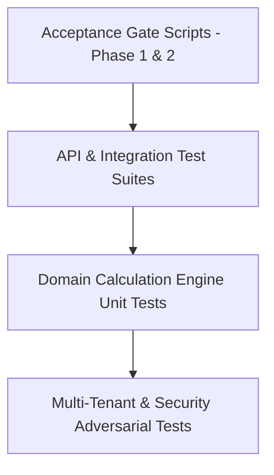

# TESTING STRATEGY & ACCEPTANCE PROTOCOL
**Project:** AI Automation Labs Multi-Tenant HRMS & SaaS Platform  
**Master Source of Truth:** Master Developer Specification (37 Sections)  
**Test Suite Engine:** Vitest 3.2.7 + TypeScript + Prisma Test Sandbox  

---

## 1. Test Architecture & Pyramidal Hierarchy



---

## 2. Test Execution Commands

```bash
# 1. Run all 20 automated Vitest test suites
npm test

# 2. Run Phase 1 Core Acceptance Gate (6/6 Gates)
npx tsx scripts/run-acceptance-gate.ts

# 3. Run Phase 2 Advanced Modules Acceptance Gate (8/8 Gates)
npx tsx scripts/run-phase2-acceptance-gate.ts

# 4. Run Complete Production Readiness Audit (12/12 Gates)
npx tsx scripts/run-production-audit.ts

# 5. Verify Database Backup & Sandbox Restore
npm run db:restore:test
```

---

## 3. Test Suites Inventory

1. `tests/tenant-isolation.test.ts` — Cross-tenant boundary and IDOR prevention.
2. `tests/rbac-permissions.test.ts` — 7 system roles, permission keys, and data scopes.
3. `tests/security-audit-rate-limit.test.ts` — Brute force rate limiting and audit logging diffs.
4. `tests/support-and-auth-reset.test.ts` — Single-use password reset tokens and support tickets.
5. `tests/attendance.test.ts` — Punch event sourcing and daily attendance state derivation.
6. `tests/leave-ledger.test.ts` — Double-entry balance transactions and manager approvals.
7. `tests/payroll-engine.test.ts` — 16-step payroll engine, statutory caps, and TDS.
8. `tests/ats-pipeline.test.ts` — Requisitions, candidate scoring, and interview scheduling.
9. `tests/onboarding.test.ts` — Onboarding checklists and document verification.
10. `tests/documents-esign.test.ts` — Template merge tags and SHA-256 e-signatures.
11. `tests/performance.test.ts` — Review cycles, OKRs, and calibrated ratings.
12. `tests/expenses.test.ts` — Multi-category claims, receipts, and dual-tier approvals.
13. `tests/exit-fnf.test.ts` — Clearances, Statutory Gratuity Act 1972, and F&F settlement.
14. `tests/ai-gateway.test.ts` — Assistant and Co-pilot RBAC context scoping.
15. `tests/ai-advanced-safety.test.ts` — Prompt injection defense and human-in-the-loop validation.
16. `tests/webhooks.test.ts` — HMAC-SHA256 signatures and webhook delivery logs.
17. `tests/reports-analytics.test.ts` — Real-time reporting and CSV export streaming.
18. `tests/saas-billing-entitlements.test.ts` — SaaS plan seat limits and trial tracking.
19. `tests/api-v1.test.ts` — REST API `/api/v1` standardized error schemas.
20. `tests/integrations-notifications.test.ts` — In-app and external notification adapters.
